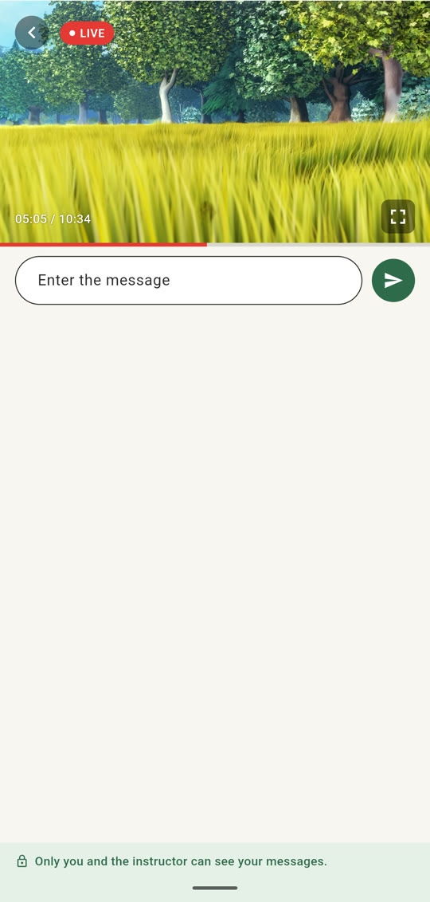
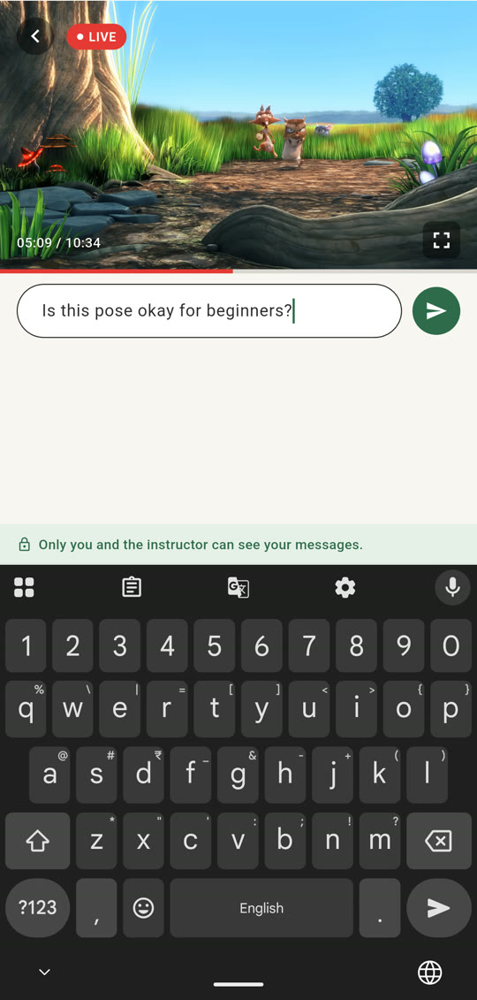
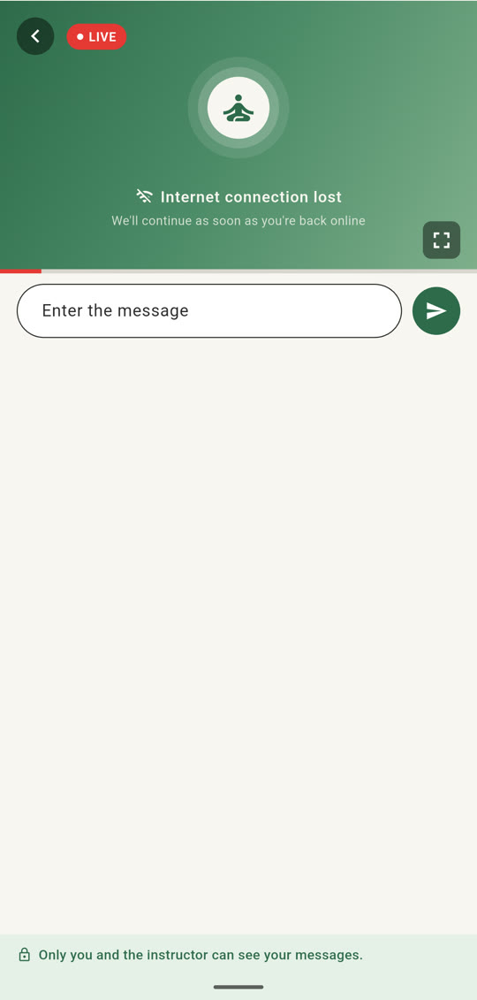
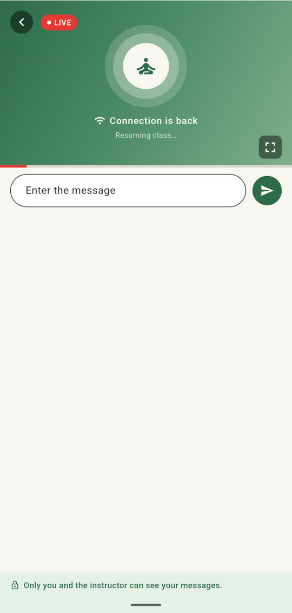
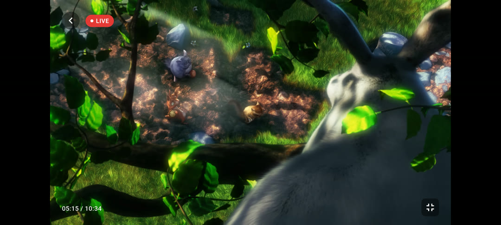

# YouTube "Live Class" Player — Prototype & Handoff

A throwaway Flutter (Android) prototype that proves we can play a **YouTube video inside our app so that it looks like our own live class**:

- None of YouTube's own UI shows (title bar, channel avatar, logo, link button, "More videos", pause/play, end-screen suggestions).
- The user has no way to reach the YouTube URL from inside the app.
- The user can't pause. The class just plays.
- Joining "late" starts the video at a given offset.
- A yoga-themed breathing animation covers the few seconds while the player warms up.
- Network problems are explained clearly ("Internet connection lost", "Weak internet connection") and the class recovers by itself.

## Screenshots

<table>
  <tr>
    <td align="center" width="33%"><br/><sub><b>Home</b>: join on time or late</sub></td>
    <td align="center" width="33%"><br/><sub><b>Loader</b>: guided breathing while the player warms up</sub></td>
    <td align="center" width="33%"><br/><sub><b>Class</b>: video with no YouTube UI ("Join 5 mins late" → 05:05)</sub></td>
  </tr>
  <tr>
    <td align="center"><br/><sub><b>Message</b>: privacy banner stays above the keyboard</sub></td>
    <td align="center"><br/><sub><b>Offline</b>: "Internet connection lost"</sub></td>
    <td align="center"><br/><sub><b>Reconnected</b>: "Connection is back, resuming class…"</sub></td>
  </tr>
  <tr>
    <td align="center" colspan="3"><br/><sub><b>Fullscreen</b>: landscape, immersive, still no YouTube UI</sub></td>
  </tr>
</table>

*Captured on a Nothing A024 (Android 17). Status bar cropped out.*

---

Everything lives in **one file, `lib/main.dart`**, so it's easy to lift into the real product. This document explains *what* we did, *why* each piece exists, and *what to keep in mind when porting it*.

> ⚠️ **Policy note — read first.** Hiding YouTube's branding, controls and links breaks the
> [YouTube API Services Developer Policies](https://developers.google.com/youtube/terms/developer-policies)
> (the player's controls and attribution must not be hidden, overlaid or blocked). This prototype was built
> for **personal / internal use only**. Shipping it publicly (e.g. Play Store) risks the API key, app removal or
> account action. For a public product, the policy-safe route is to **host the videos ourselves** and play them with
> `video_player` (+ signed URLs / DRM). See [Going to production](#going-to-production).

---

## 1. What the prototype does

| Screen | Behaviour |
|---|---|
| **Home** | Blank page with four buttons: *Join class* (00:00), *Join 2:30 mins late* (02:30), *Join 5 mins late* (05:00), *Join 08:15 mins late* (08:15). |
| **Live class** | Matches the design mock: video at the top with a back button, red **LIVE** pill, `mm:ss / mm:ss` time, fullscreen button, thin red progress bar, message box with a green send button, and the *"Only you and the instructor can see your messages"* banner, which stays above the keyboard. |
| **Loading** | A green panel with a meditating figure inside a breathing circle (*Breathe in… / Breathe out…*, ~4 s per breath). It covers the video until YouTube's own UI has gone. |
| **Network trouble** | The same loader, with a clear message (see [4.9](#49-network-problems-clear-messages-and-self-recovery)). |
| **Fullscreen** | Landscape and immersive, video only. Back or the exit button returns to portrait. |

Test video: `aqz-KE-bpKQ` (Blender's *Big Buck Bunny*, CC-BY).

---

## 2. Stack

| Thing | Version | Why |
|---|---|---|
| Flutter | 3.50 (Dart 3.14) | — |
| [`youtube_player_iframe`](https://pub.dev/packages/youtube_player_iframe) | 6.0.3 | Wraps YouTube's official IFrame Player API in a WebView. |
| [`webview_flutter`](https://pub.dev/packages/webview_flutter) | 4.14.1 | Direct dependency so we can replace the player's `NavigationDelegate` (link blocking) and create the pre-warm WebView. |
| [`connectivity_plus`](https://pub.dev/packages/connectivity_plus) | 7.3.2 | Online / offline detection for the loader message and reconnect handling. |

Android manifest: `android.permission.INTERNET` added.

We looked at [`youtube_player_flutter`](https://github.com/sarbagyastha/youtube_player_flutter), the older sibling package in the same repo. It doesn't help: it uses the same YouTube iframe underneath, so the same overlays appear and the same workarounds would be needed.

---

## 3. The core problem

The video plays inside **YouTube's iframe in a WebView**. Everything YouTube draws (title, logo, link, pause bar, "More videos", end screen) lives **inside a cross-origin iframe**, so we **cannot style, hide or remove it with CSS/JS**. The only levers we have are:

1. **Player parameters**, which turn off what YouTube allows us to turn off.
2. **Not touching the player**, so YouTube's UI isn't triggered by hover or tap.
3. **Covering the player** at the moments YouTube shows its UI anyway.
4. **Never doing the things that make YouTube show its UI** (resizing, seeking).
5. **Blocking navigation** out of the WebView.

Each technique below is one of these.

---

## 4. Techniques (and why each exists)

Each technique below was found by recording the phone screen (see [§6](#6-how-we-verified-things)), not by guessing.

### 4.1 Turn off what YouTube lets us turn off
```dart
YoutubePlayerParams(
  showControls: false,          // controls=0 — no control bar / logo bar during play
  showFullscreenButton: false,
  showVideoAnnotations: false,
  strictRelatedVideos: true,
  enableCaption: false,
  pointerEvents: PointerEvents.none, // iframe never gets touches → UI never wakes up
  mute: true,                        // see 4.6
)
```
`controls=0` alone is **not enough**. YouTube still shows its title bar at start, a "More videos" bar on pause, an overlay on resize, and suggestions at the end.

### 4.2 Block every link (URL can't leave the app)
The package by default opens logo, title and share taps with `url_launcher` (in the YouTube app or a browser). We replace its navigation delegate:
```dart
_controller.webViewController.setNavigationDelegate(
  NavigationDelegate(onNavigationRequest: (_) => NavigationDecision.prevent),
);
```

### 4.3 Overlays MUST go through `controlsBuilder` (gotcha!)
On Android and iOS, `youtube_player_iframe` renders the WebView inside an **`OverlayPortal` above the whole page**. Anything you put on top of `YoutubePlayer` in a normal `Stack` is drawn **underneath** the video and is invisible. That's why our back button, LIVE pill and cover didn't show at first.

✅ Everything drawn over the video (cover, loader, back, LIVE, time, fullscreen) is returned from **`YoutubePlayer(controlsBuilder: ...)`**, which the package draws above the WebView.

### 4.4 Cover the player whenever YouTube would show UI
`_PlayerControls` listens to `controller.stream` and shows an opaque cover:

| Player state | Cover |
|---|---|
| not started / cued | breathing loader |
| `buffering` (**including mid-class stalls**) | breathing loader. During a stall YouTube shows its *full* overlay (title, "More videos", logo, spinner). |
| `paused` | breathing loader (and we immediately call `playVideo()`; see 4.7) |
| `ended` | video thumbnail (hides YouTube's end-screen suggestions) |
| `playing` after a pause | stays up **1.2 s more** (`_settle`): YouTube's pause bar *fades* out after resuming |
| `playing` after buffering | stays up **5 s more** (`_afterBuffering`): YouTube keeps its overlay up ~4 s after a stall (measured: still visible at 4.0 s, gone by 4.25 s) |

The time label stays mounted while hidden (`Visibility(maintainState: true)`); otherwise it flashes `00:00` when it reappears.

How the stall was reproduced: start playback, then `adb shell svc wifi disable && adb shell svc data disable` until the player logs `buffering` (~30–60 s, once the buffer drains), re-enable both, and screen-record the recovery. In debug builds every state change is printed as `[player] state=...`.

### 4.5 Never resize the iframe → fixed-size player that is only *scaled*
**Finding:** whenever the iframe changes size (e.g. entering or leaving fullscreen), YouTube shows its title, link, logo and pause overlay for **~6–7 s**.

**Fix:** the `YoutubePlayer` is laid out **once** at a fixed landscape-sized resolution (`baseW = screen.longestSide`, 16:9) and then only **scaled** with `FittedBox` into either the inline slot or the fullscreen area. YouTube never sees a resize, so it never shows the overlay.

- The package's overlay follows the placeholder via `CompositedTransformFollower`, so it inherits our scale automatically.
- Because the controls layer inherits the scale too, we **undo** it for the controls (`FittedBox` around a `SizedBox(baseW * scale, baseH * scale)`) so buttons stay normal size.
- Fullscreen is therefore **our own** (`_setFullscreen`: orientation + immersive mode + new rect/scale), **not** the package's `enterFullScreen()`, which resizes the WebView. `autoFullScreen` and `enableFullScreenOnVerticalDrag` are off.
- The `YoutubePlayer` widget stays at the **same place in the widget tree** in both modes (only the rect and scale change), so the WebView is never recreated.

### 4.6 Hide YouTube's start-of-playback overlay (muted intro hold)
**Finding:** for **~4.2 s after playback starts**, YouTube shows an overlay even with `controls=0`: the **title bar** at the top (channel avatar + title), a **pause icon in the centre** and a **"More videos" chip at the bottom**. Measured from 8 fps recordings: pause icon and chip gone at ~+3.6 s, title gone at ~+4.2 s.

**Fix:**
1. Start the player **muted**, **4.5 s before** the requested position (`startSeconds - 4.5`, clamped at 0).
2. Keep the full cover up for **4.5 s after the first `playing` event** (`_PlayerControlsState._introHold`).
3. Then **unmute only**. Playback is now exactly at the requested time (verified: "Join 2:30 mins late" reveals at `02:30`).

❌ **Don't seek** to fix the offset after the hold. We tried: `seekTo()` makes YouTube show its title bar and pause icon **again** for ~3–4 s. Unmuting does not.

❌ **Don't try to cover only the top strip.** We tried revealing the video after 0.8 s with a branded header band over the title area. It hid the title, but the centre pause icon and "More videos" chip were visible for ~3 s. The overlay covers the whole player, so the cover has to as well.

**Why 4.5 s can't be cut much:** the hold is only ~0.3 s longer than YouTube's own overlay, and every way of starting playback (load, seek, new video) triggers that overlay. What *can* be cut is the time **before** playback starts; see 4.10.

Trade-off: when starting at 00:00 the first 4.5 s play muted behind the loader (for this video that's just the title card).

### 4.7 No pause, ever
- Taps on the video are swallowed (`AbsorbPointer`). There is no play/pause UI.
- If the player reports `paused` while the app is in the foreground (WebView hiccup, etc.), we call `playVideo()` immediately.
- `AppLifecycleListener(onResume: playVideo)`: Android pauses the WebView in the background, so we resume when the user returns.

### 4.8 Show the loader from the very first frame (no package thumbnail)
**Finding:** while the player boots, the package draws **its own thumbnail on top of everything** (including `controlsBuilder`), but only if the controller has a `key`.

**Fix:**
- Create the controller **without a key** (`YoutubePlayerController(params: ...)` instead of `.fromVideoId(...)`), then call `loadVideoById(...)` right after.
- Pass `backgroundColor: Colors.transparent` to `YoutubePlayer`. With no key, the package's boot layer is a plain box of that colour, so it's see-through and our loader shows from frame one.

### 4.9 Network problems: clear messages and self-recovery
The loader text depends on what's going on (`_PlayerControlsState._message`):

| Situation | Headline | Sub-line |
|---|---|---|
| Normal start | *Breathe in… / Breathe out…* | Settle in, class is starting |
| Device offline (`connectivity_plus` reports no network) | 📵 **Internet connection lost** | We'll continue as soon as you're back online |
| Online but the video stalled mid-class | **Weak internet connection** | Hang on, the class will resume shortly |
| Stall over, waiting out YouTube's post-stall overlay (`_afterBuffering`) | **Connection is back** | Resuming class… |

Recovery:
- **Back online after a mid-class stall:** we call `playVideo()` as a nudge; YouTube resumes from its buffer position.
- **Joined while offline:** YouTube's player script never downloaded, so nothing can resume. When the connection returns and the class has never played, `LiveClassPage._restartPlayer()` throws the controller away and builds a fresh one (`YoutubePlayer` is keyed by `ObjectKey(_controller)`). Verified: playing ~5 s after reconnect.

Note: `connectivity_plus` only knows whether there is *a network*, not whether it reaches the internet. "Wi-Fi connected but no internet" therefore shows **Weak internet connection**.

### 4.10 Faster first join: pre-warm on the home screen
**Finding** (debug build, `[player] +Nms` logs): tap → first `playing` took **2.3 s** on the first join after launch and **0.8–1.5 s** on later joins. The difference is Android starting its WebView engine and downloading YouTube's player scripts.

**Fix:** `HomePage` creates a hidden, never-displayed `WebViewController` that loads `https://www.youtube-nocookie.com/embed/<id>?controls=0` (no autoplay; navigation locked to the embed page). The engine is then warm and the scripts cached when the user taps Join. Measured first join after launch: **1.7 s** (was 2.3 s).

Total wait now: ~1–1.7 s boot + 4.5 s intro hold.

**Bigger win for the real product:** in a real live class the "minutes late" offset is known before the user taps Join (it's *now − class start*). A lobby or class-details screen could start the real player muted and hidden in the background, so the intro hold has already passed by the time the user joins. That needs the player to live above the route (one shared `YoutubePlayer`), because the package reloads the player page whenever a `YoutubePlayer` widget is created.

---

## 5. Code map (`lib/main.dart`)

| Piece | What it is |
|---|---|
| `HomePage` | The four "Join …" buttons; `starts` list = `(label, seconds)`. |
| `LiveClassPage(startSeconds:)` | Owns the controller (early muted start, 4.6), fullscreen (4.5), player restart (4.9), page layout. |
| `_PlayerControls` | Everything drawn over the video; cover logic (4.4), intro hold (4.6), no-pause (4.7), network messages and reconnect (4.9). |
| `_Cover` / `_BreathingLoader` / `_LoaderMessage` | Loader (breathing, `_half` = 2 s in / 2 s out) with the current message, or end-of-video thumbnail. |
| `_HomePageState._warmUp` | Hidden pre-warm WebView (4.10). |
| `_ProgressBar`, `_MessageInput`, `_PrivacyBanner`, `_LiveBadge`, `_GlassButton` | UI from the design mock. Messages are **not sent anywhere** yet (field just clears). |

Tunables:

| Constant | Value | Meaning |
|---|---|---|
| `_introHold` | 4500 ms | Muted cover after first play; must outlast YouTube's start overlay (~4.2 s). The early start uses the same value. |
| `_settle` | 1200 ms | Cover after any later resume; outlasts the pause-bar fade. |
| `_afterBuffering` | 5000 ms | Cover after recovering from a stall; outlasts YouTube's ~4 s post-stall overlay. |
| `_BreathingLoader._half` | 2000 ms | Half a breath. |

---

## 6. How we verified things

The phone was connected over USB and we used `adb` to drive the app and **record the screen**, then turned the recording into a contact sheet of frames to see exactly when YouTube's UI appears:

```bash
export MSYS_NO_PATHCONV=1   # Git Bash on Windows: stop it rewriting /sdcard paths
adb shell screenrecord --time-limit 12 --size 630x1400 /sdcard/load.mp4 &
adb shell input tap 630 1148            # tap a button (physical px)
adb pull /sdcard/load.mp4 load.mp4
ffmpeg -i load.mp4 -vf "fps=4,crop=630:290:0:55,tile=4x12" -frames:v 1 sheet.png
```
At 4 fps, each frame is 250 ms (we used 8 fps for the intro overlay), which is how we measured the ~4.2 s start overlay and the ~6–7 s resize overlay.

Network tests: `adb shell svc wifi disable && adb shell svc data disable` to go offline, `... enable` to come back. In debug builds the app logs `[player] +<ms> state=...` and `[player] offline=...`.

Status of checks on the test device (Nothing A024, Android 17):
- ✅ Load → loader → clean video, at the right timestamp (00:00, 02:30, 05:00 checked)
- ✅ Fullscreen in and out without YouTube UI
- ✅ Tapping the video does nothing
- ✅ Mid-class buffering stall (network cut) → "Internet connection lost" → "Connection is back" → clean video
- ✅ Joining while offline → "Internet connection lost" → player restarts on reconnect, playing ~5 s later
- ✅ Pre-warm: first join tap → playing 1.7 s (was 2.3 s)
- ⚠️ **"Weak internet connection"** (online but stalling) was **not** tested: there's no way to throttle the phone's network without root. Only the offline path was exercised.
- ✅ No Flutter exceptions in logs
- ⚠️ **Audio returning after unmute was not checked by ear.** Please confirm.
- ⚠️ Not tested on iOS (the package behaves differently there; e.g. its navigation handling and OverlayPortal paths).
- ⚠️ Release APK was built but not installed and tried on the device.

---

## 7. Known limitations / risks

- **Policy** (see top). This is the big one.
- **Fragile by nature:** every timing (4 s title, 1.2 s fade, resize overlay) is **YouTube behaviour we observed**, not a documented contract. A YouTube player update can break it. Re-run the screen-record check after any player change.
- **Slow networks:** every stall shows the loader and adds ~5 s of cover after recovery. On a very flaky connection the user may see the loader often. (There's a tiny window, ≤ one state update ~100 ms, between YouTube drawing its stall overlay and our cover appearing.)
- **Recovery after a long outage can be slow:** in one test YouTube took ~34 s after the network returned to resume (its own retry back-off), even with our `playVideo()` nudge. A real product may want a "Reconnect" fallback that restarts the player after N seconds.
- **The URL is not truly secret:** the video ID is in the app binary and in network traffic. Fine for "no way from the UI"; not DRM.
- **Muted autoplay at 00:00** loses the first 4.5 s of the video (see 4.6).
- Time label is white on video; hard to read on bright scenes (could add a bottom gradient).
- The `LIVE` pill is decorative; this is a VOD.
- Release build is signed with the **debug key** (Flutter template default).

---

## 8. Porting checklist (into the real app)

1. Add `youtube_player_iframe`, `webview_flutter` and `connectivity_plus`. Make sure Android has `INTERNET`.
2. Copy `LiveClassPage` and its private widgets. Turn `videoId` / `startSeconds` into real inputs (class ID → video ID, computed "minutes late" from the class start time instead of hard-coded buttons).
3. **Keep these exactly** (each one fixes an observed leak):
   - params in 4.1
   - navigation delegate in 4.2
   - all overlays via `controlsBuilder` (4.3)
   - fixed-size scaled player and our own fullscreen (4.5)
   - muted early start + unmute-only, **no seek** (4.6)
   - keyless controller + transparent `backgroundColor` (4.8)
   - player restart when reconnecting before the first play (4.9)
4. Only **one** `YoutubePlayer` per screen. The package coordinates fullscreen across instances with static state.
5. Wire the message box to the real instructor-chat backend.
6. Move the pre-warm (4.10) to whatever screen comes before joining, or go further with a background-started player.
7. Swap colours and fonts for the product theme (`cream`, `green`, `liveRed`, …). The design mock likely uses Inter.
8. Re-verify with the screen-record method in §6 on low-end and high-end devices and slow networks.
9. Unused dependencies: `pubspec.yaml` also lists `material_ui` and `cupertino_icons`, which `lib/main.dart` doesn't import. Drop them unless the real app needs them. (`flutter analyze` reports one info that `flutter/material.dart` is deprecated in favour of `material_ui`. It doesn't affect building or running.)

## Going to production

If this becomes public-facing, replace the YouTube layer instead of hardening it:

- Host videos ourselves (or Cloudflare Stream / Mux / Bunny) and play with **`video_player`** (or `better_player` / `media_kit`).
- Don't ship URLs in the app. Fetch **short-lived signed URLs** from our backend; add **Widevine DRM** if the content matters.
- `FLAG_SECURE` to block screenshots and screen recording.
- Most of §4 then disappears. The UI (`_PlayerControls`, loader, layout, late-join via `seekTo`) carries over almost unchanged, because a native player has no overlays to hide and seeking doesn't show any UI.

---

## Run / build

```bash
flutter pub get
flutter run -d <device-id>          # debug on a connected phone
flutter build apk --release         # → build/app/outputs/flutter-apk/app-release.apk
```
