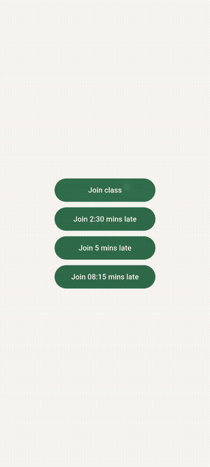

# YouTube "Live Class" Player — Prototype & Handoff

A throwaway Flutter (Android) prototype that proves we can play a **YouTube video inside our app so that it looks like our own live class**:

- None of YouTube's own UI shows (title bar, channel avatar, logo, link button, "More videos", pause/play, end-screen suggestions).
- The user has no way to reach the YouTube URL from inside the app.
- The user can't pause. The class just plays.
- Joining "late" starts the video at a given offset.
- A yoga-themed breathing animation covers the few seconds while the player warms up.

## Demo

<p align="center">
  
</p>

▶️ Full-quality recording (32 s, 1080×2400): [`docs/demo.mp4`](docs/demo.mp4)

*Shown: breathing loader → video with no YouTube UI → typing in the message box → back to home → "Join 5 mins late" (reveals at 05:00).*

---

Everything lives in **one file, `lib/main.dart`**, so it's easy to lift into the real product. This document explains *what* we did, *why* each piece exists, and *what to keep in mind when porting it*.

> ⚠️ **Policy note — read first.** Hiding YouTube's branding, controls and links breaks the
> [YouTube API Services Developer Policies](https://developers.google.com/youtube/terms/developer-policies)
> (the player's controls and attribution must not be hidden, overlaid or blocked). This prototype was built
> for **personal / internal use only**. Shipping it publicly (e.g. Play Store) risks the API key, app removal or
> account action. For a public product, the policy-safe route is to **host the videos ourselves** and play them with
> `video_player` (+ signed URLs / DRM). See [Going to production](#going-to-production).

---

## 1. What the prototype does

| Screen | Behaviour |
|---|---|
| **Home** | Blank page with four buttons: *Join class* (00:00), *Join 2:30 mins late* (02:30), *Join 5 mins late* (05:00), *Join 08:15 mins late* (08:15). |
| **Live class** | Matches the design mock: video at the top with a back button, red **LIVE** pill, `mm:ss / mm:ss` time, fullscreen button, thin red progress bar, message box with a green send button, and the *"Only you and the instructor can see your messages"* banner, which stays above the keyboard. |
| **Loading** | A green panel with a meditating figure inside a breathing circle (*Breathe in… / Breathe out…*, ~4 s per breath). It covers the video until YouTube's own UI has gone. |
| **Fullscreen** | Landscape and immersive, video only. Back or the exit button returns to portrait. |

Test video: `aqz-KE-bpKQ` (Blender's *Big Buck Bunny*, CC-BY).

---

## 2. Stack

| Thing | Version | Why |
|---|---|---|
| Flutter | 3.50 (Dart 3.14) | — |
| [`youtube_player_iframe`](https://pub.dev/packages/youtube_player_iframe) | 6.0.3 | Wraps YouTube's official IFrame Player API in a WebView. |
| [`webview_flutter`](https://pub.dev/packages/webview_flutter) | 4.14.1 | Direct dependency only so we can replace the player's `NavigationDelegate` (link blocking). |

Android manifest: `android.permission.INTERNET` added.

We looked at [`youtube_player_flutter`](https://github.com/sarbagyastha/youtube_player_flutter), the older sibling package in the same repo. It doesn't help: it uses the same YouTube iframe underneath, so the same overlays appear and the same workarounds would be needed.

---

## 3. The core problem

The video plays inside **YouTube's iframe in a WebView**. Everything YouTube draws (title, logo, link, pause bar, "More videos", end screen) lives **inside a cross-origin iframe**, so we **cannot style, hide or remove it with CSS/JS**. The only levers we have are:

1. **Player parameters**, which turn off what YouTube allows us to turn off.
2. **Not touching the player**, so YouTube's UI isn't triggered by hover or tap.
3. **Covering the player** at the moments YouTube shows its UI anyway.
4. **Never doing the things that make YouTube show its UI** (resizing, seeking).
5. **Blocking navigation** out of the WebView.

Each technique below is one of these.

---

## 4. Techniques (and why each exists)

Each technique below was found by recording the phone screen (see [§6](#6-how-we-verified-things)), not by guessing.

### 4.1 Turn off what YouTube lets us turn off
```dart
YoutubePlayerParams(
  showControls: false,          // controls=0 — no control bar / logo bar during play
  showFullscreenButton: false,
  showVideoAnnotations: false,
  strictRelatedVideos: true,
  enableCaption: false,
  pointerEvents: PointerEvents.none, // iframe never gets touches → UI never wakes up
  mute: true,                        // see 4.6
)
```
`controls=0` alone is **not enough**. YouTube still shows its title bar at start, a "More videos" bar on pause, an overlay on resize, and suggestions at the end.

### 4.2 Block every link (URL can't leave the app)
The package by default opens logo, title and share taps with `url_launcher` (in the YouTube app or a browser). We replace its navigation delegate:
```dart
_controller.webViewController.setNavigationDelegate(
  NavigationDelegate(onNavigationRequest: (_) => NavigationDecision.prevent),
);
```

### 4.3 Overlays MUST go through `controlsBuilder` (gotcha!)
On Android and iOS, `youtube_player_iframe` renders the WebView inside an **`OverlayPortal` above the whole page**. Anything you put on top of `YoutubePlayer` in a normal `Stack` is drawn **underneath** the video and is invisible. That's why our back button, LIVE pill and cover didn't show at first.

✅ Everything drawn over the video (cover, loader, back, LIVE, time, fullscreen) is returned from **`YoutubePlayer(controlsBuilder: ...)`**, which the package draws above the WebView.

### 4.4 Cover the player whenever YouTube would show UI
`_PlayerControls` listens to `controller.stream` and shows an opaque cover:

| Player state | Cover |
|---|---|
| not started / cued / buffering-before-first-play | breathing loader |
| `paused` | breathing loader (and we immediately call `playVideo()`; see 4.7) |
| `ended` | video thumbnail (hides YouTube's end-screen suggestions) |
| `playing` | stays up for **1.2 s more** (`_settle`) because YouTube's pause bar *fades* out after resuming |

### 4.5 Never resize the iframe → fixed-size player that is only *scaled*
**Finding:** whenever the iframe changes size (e.g. entering or leaving fullscreen), YouTube shows its title, link, logo and pause overlay for **~6–7 s**.

**Fix:** the `YoutubePlayer` is laid out **once** at a fixed landscape-sized resolution (`baseW = screen.longestSide`, 16:9) and then only **scaled** with `FittedBox` into either the inline slot or the fullscreen area. YouTube never sees a resize, so it never shows the overlay.

- The package's overlay follows the placeholder via `CompositedTransformFollower`, so it inherits our scale automatically.
- Because the controls layer inherits the scale too, we **undo** it for the controls (`FittedBox` around a `SizedBox(baseW * scale, baseH * scale)`) so buttons stay normal size.
- Fullscreen is therefore **our own** (`_setFullscreen`: orientation + immersive mode + new rect/scale), **not** the package's `enterFullScreen()`, which resizes the WebView. `autoFullScreen` and `enableFullScreenOnVerticalDrag` are off.
- The `YoutubePlayer` widget stays at the **same place in the widget tree** in both modes (only the rect and scale change), so the WebView is never recreated.

### 4.6 Hide YouTube's start-of-playback title bar (muted intro hold)
**Finding:** for **~4 s after playback starts**, YouTube shows its title bar (channel avatar + video title), even with `controls=0`.

**Fix:**
1. Start the player **muted**, **4.5 s before** the requested position (`startSeconds - 4.5`, clamped at 0).
2. Keep the cover up (`holdCover`) for **4.5 s after the first `playing` event** (`_introHold`).
3. Then **unmute only**. Playback is now exactly at the requested time (verified: "Join 2:30 mins late" reveals at `02:30`).

❌ **Don't seek** to fix the offset after the hold. We tried: `seekTo()` makes YouTube show its title bar and pause icon **again** for ~3–4 s. Unmuting does not.

Trade-off: when starting at 00:00 the first 4.5 s play muted behind the loader (for this video that's just the title card).

### 4.7 No pause, ever
- Taps on the video are swallowed (`AbsorbPointer`). There is no play/pause UI.
- If the player reports `paused` while the app is in the foreground (WebView hiccup, etc.), we call `playVideo()` immediately.
- `AppLifecycleListener(onResume: playVideo)`: Android pauses the WebView in the background, so we resume when the user returns.

### 4.8 Show the loader from the very first frame (no package thumbnail)
**Finding:** while the player boots, the package draws **its own thumbnail on top of everything** (including `controlsBuilder`), but only if the controller has a `key`.

**Fix:**
- Create the controller **without a key** (`YoutubePlayerController(params: ...)` instead of `.fromVideoId(...)`), then call `loadVideoById(...)` right after.
- Pass `backgroundColor: Colors.transparent` to `YoutubePlayer`. With no key, the package's boot layer is a plain box of that colour, so it's see-through and our loader shows from frame one.

---

## 5. Code map (`lib/main.dart`)

| Piece | What it is |
|---|---|
| `HomePage` | The four "Join …" buttons; `starts` list = `(label, seconds)`. |
| `LiveClassPage(startSeconds:)` | Owns the controller, intro hold (4.6), fullscreen (4.5), page layout. |
| `_PlayerControls` | Everything drawn over the video; cover logic (4.4), no-pause (4.7). |
| `_Cover` / `_BreathingLoader` | Loader (breathing, `_half` = 2 s in / 2 s out) or end-of-video thumbnail. |
| `_ProgressBar`, `_MessageInput`, `_PrivacyBanner`, `_LiveBadge`, `_GlassButton` | UI from the design mock. Messages are **not sent anywhere** yet (field just clears). |

Tunables:

| Constant | Value | Meaning |
|---|---|---|
| `_introHold` | 4500 ms | Muted cover after first play; must outlast YouTube's start title bar (~4 s). |
| `_settle` | 1200 ms | Cover after any later resume; outlasts the pause-bar fade. |
| `_BreathingLoader._half` | 2000 ms | Half a breath. |

---

## 6. How we verified things

The phone was connected over USB and we used `adb` to drive the app and **record the screen**, then turned the recording into a contact sheet of frames to see exactly when YouTube's UI appears:

```bash
export MSYS_NO_PATHCONV=1   # Git Bash on Windows: stop it rewriting /sdcard paths
adb shell screenrecord --time-limit 12 --size 630x1400 /sdcard/load.mp4 &
adb shell input tap 630 1148            # tap a button (physical px)
adb pull /sdcard/load.mp4 load.mp4
ffmpeg -i load.mp4 -vf "fps=4,crop=630:290:0:55,tile=4x12" -frames:v 1 sheet.png
```
At 4 fps, each frame is 250 ms, which is how we measured the ~4 s start title bar and the ~6–7 s resize overlay.

Status of checks on the test device (Nothing A024, Android 17):
- ✅ Load → loader → clean video, at the right timestamp (00:00, 02:30, 05:00 checked)
- ✅ Fullscreen in and out without YouTube UI
- ✅ Tapping the video does nothing
- ✅ No Flutter exceptions in logs
- ⚠️ **Audio returning after unmute was not checked by ear.** Please confirm.
- ⚠️ Not tested on iOS (the package behaves differently there; e.g. its navigation handling and OverlayPortal paths).
- ⚠️ Release APK was built but not installed and tried on the device.

---

## 7. Known limitations / risks

- **Policy** (see top). This is the big one.
- **Fragile by nature:** every timing (4 s title, 1.2 s fade, resize overlay) is **YouTube behaviour we observed**, not a documented contract. A YouTube player update can break it. Re-run the screen-record check after any player change.
- **Slow networks:** the cover lifts 4.5 s after the *first* `playing` event. Buffering after that is shown as plain video (with YouTube's own spinner, if any).
- **The URL is not truly secret:** the video ID is in the app binary and in network traffic. Fine for "no way from the UI"; not DRM.
- **Muted autoplay at 00:00** loses the first 4.5 s of the video (see 4.6).
- Time label is white on video; hard to read on bright scenes (could add a bottom gradient).
- The `LIVE` pill is decorative; this is a VOD.
- Release build is signed with the **debug key** (Flutter template default).

---

## 8. Porting checklist (into the real app)

1. Add `youtube_player_iframe` and `webview_flutter`. Make sure Android has `INTERNET`.
2. Copy `LiveClassPage` and its private widgets. Turn `videoId` / `startSeconds` into real inputs (class ID → video ID, computed "minutes late" from the class start time instead of hard-coded buttons).
3. **Keep these exactly** (each one fixes an observed leak):
   - params in 4.1
   - navigation delegate in 4.2
   - all overlays via `controlsBuilder` (4.3)
   - fixed-size scaled player and our own fullscreen (4.5)
   - muted early start + unmute-only, **no seek** (4.6)
   - keyless controller + transparent `backgroundColor` (4.8)
4. Only **one** `YoutubePlayer` per screen. The package coordinates fullscreen across instances with static state.
5. Wire the message box to the real instructor-chat backend.
6. Swap colours and fonts for the product theme (`cream`, `green`, `liveRed`, …). The design mock likely uses Inter.
7. Re-verify with the screen-record method in §6 on low-end and high-end devices and slow networks.
8. Unused dependencies: `pubspec.yaml` also lists `material_ui` and `cupertino_icons`, which `lib/main.dart` doesn't import. Drop them unless the real app needs them. (`flutter analyze` reports one info that `flutter/material.dart` is deprecated in favour of `material_ui`. It doesn't affect building or running.)

## Going to production

If this becomes public-facing, replace the YouTube layer instead of hardening it:

- Host videos ourselves (or Cloudflare Stream / Mux / Bunny) and play with **`video_player`** (or `better_player` / `media_kit`).
- Don't ship URLs in the app. Fetch **short-lived signed URLs** from our backend; add **Widevine DRM** if the content matters.
- `FLAG_SECURE` to block screenshots and screen recording.
- Most of §4 then disappears. The UI (`_PlayerControls`, loader, layout, late-join via `seekTo`) carries over almost unchanged, because a native player has no overlays to hide and seeking doesn't show any UI.

---

## Run / build

```bash
flutter pub get
flutter run -d <device-id>          # debug on a connected phone
flutter build apk --release         # → build/app/outputs/flutter-apk/app-release.apk
```
