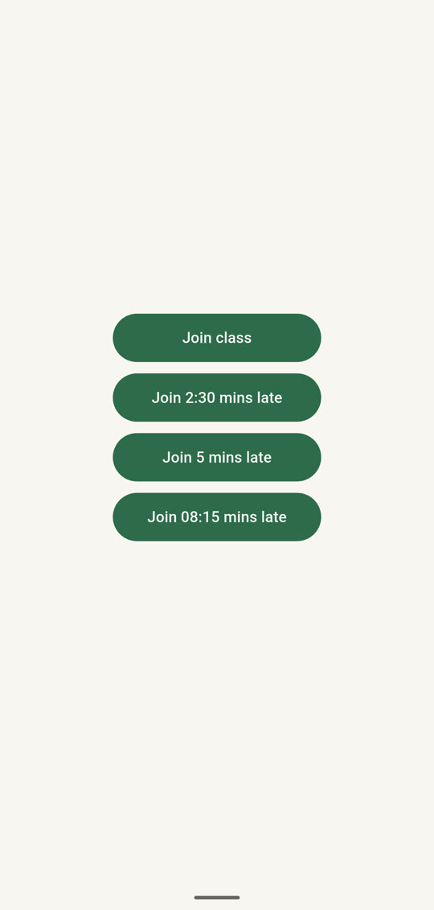
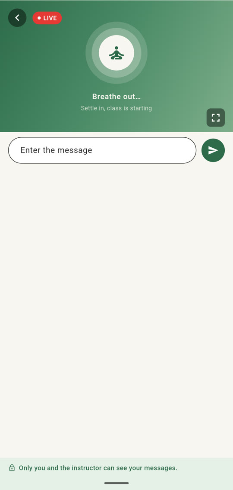
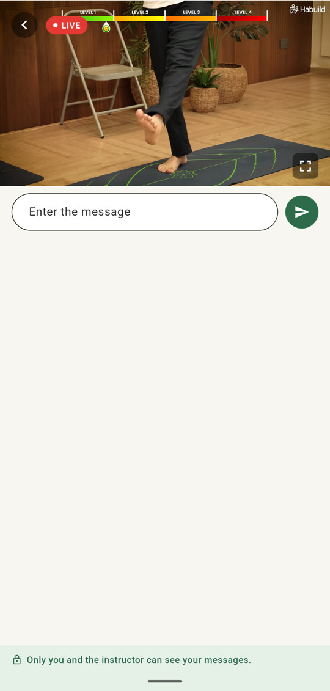
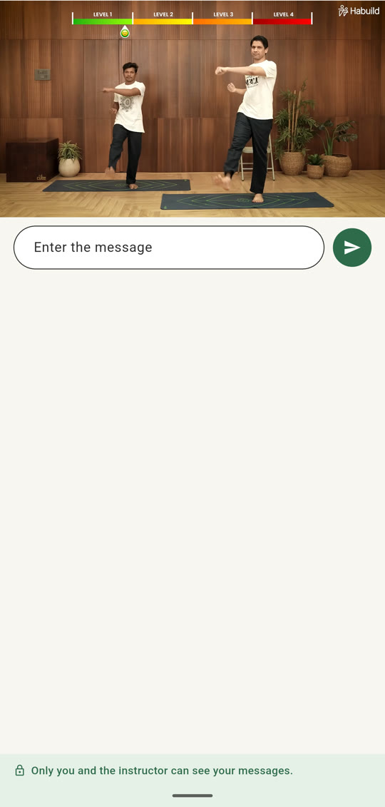
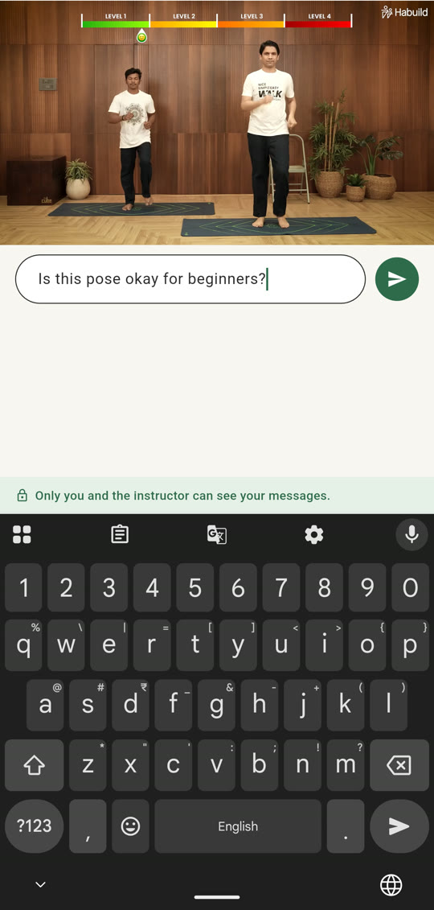
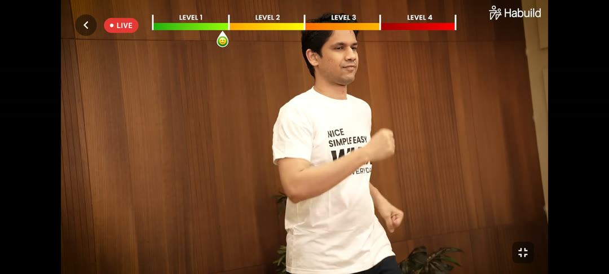
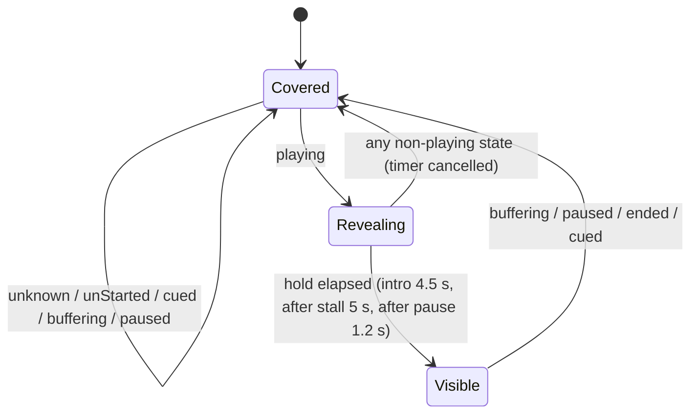

# YouTube Live-Class Player (Flutter, Android)

Prototype of an in-app "live class" player that plays a **YouTube video** with **no YouTube UI and no reachable URL**. Everything YouTube would normally draw (title bar, channel avatar, logo, share/link, "More videos", pause icon, captions, end screen) is suppressed, hidden behind our own UI, or never triggered. On top sits a custom UI built from a design mock:
- back button, **LIVE** pill and fullscreen button (fade out after 3 s)
- a yoga-themed breathing loader
- network-aware messages
- an instructor message box

> **Scope.** Internal / personal prototype. Hiding YouTube's controls and attribution is not permitted by the
> [YouTube API Services Developer Policies](https://developers.google.com/youtube/terms/developer-policies).
> For a public release see [§11 Production path](#11-production-path).

---

## Screenshots

<table>
  <tr>
    <td align="center" width="25%"><br/><sub><b>Home</b>: join on time or late</sub></td>
    <td align="center" width="25%"><br/><sub><b>Loader</b>: covers boot + intro overlay</sub></td>
    <td align="center" width="25%"><br/><sub><b>Playing</b>: buttons after reveal</sub></td>
    <td align="center" width="25%"><br/><sub><b>Playing</b>: buttons faded</sub></td>
  </tr>
  <tr>
    <td align="center"><br/><sub><b>Message</b>: banner above the IME</sub></td>
    <td align="center"><br/><sub><b>Stall, offline</b></sub></td>
    <td align="center"><br/><sub><b>Stall, online</b></sub></td>
    <td align="center"><br/><sub><b>Recovering</b>: post-stall hold</sub></td>
  </tr>
  <tr>
    <td align="center" colspan="4"><br/><sub><b>Fullscreen</b>: same WebView, scaled, never resized</sub></td>
  </tr>
</table>

<sub>Nothing A024 · Android 17 · video <code>DJ4-cgGjn1s</code>. The level bar and "Habuild" logo are burned into the video itself; they are not YouTube UI. Status bar cropped.</sub>

---

## Contents

1. [Stack](#1-stack)
2. [Architecture](#2-architecture)
3. [Constraints of the YouTube embed](#3-constraints-of-the-youtube-embed)
4. [Player configuration](#4-player-configuration)
5. [Fixed-size scaled player and custom fullscreen](#5-fixed-size-scaled-player-and-custom-fullscreen)
6. [Cover state machine](#6-cover-state-machine)
7. [Network handling](#7-network-handling)
8. [Startup latency](#8-startup-latency)
9. [UI layer](#9-ui-layer)
10. [Verification method and results](#10-verification-method-and-results)
11. [Production path](#11-production-path)
12. [Limitations](#12-limitations)
13. [Porting checklist](#13-porting-checklist)
14. [Rejected approaches](#14-rejected-approaches)
15. [Build and run](#15-build-and-run)

---

## 1. Stack

| Component | Version | Role |
|---|---|---|
| Flutter / Dart | 3.50 / 3.14 | App, single file `lib/main.dart` |
| [`youtube_player_iframe`](https://pub.dev/packages/youtube_player_iframe) | 6.0.3 | YouTube IFrame Player API inside a WebView |
| [`webview_flutter`](https://pub.dev/packages/webview_flutter) | 4.14.1 | Direct dependency: replace the player's `NavigationDelegate`; pre-warm WebView |
| [`connectivity_plus`](https://pub.dev/packages/connectivity_plus) | 7.3.2 | Online/offline signal for messages and recovery |

`AndroidManifest.xml`: `android.permission.INTERNET`. `connectivity_plus` merges `ACCESS_NETWORK_STATE` itself.

`youtube_player_flutter` (the older package in the same repo) was evaluated and rejected: it wraps the same iframe, so it has the same overlays and needs the same workarounds.

---

## 2. Architecture

```
MaterialApp
└─ HomePage (StatefulWidget)
   ├─ _warmUp: hidden WebViewController (pre-warm, §8)
   └─ Join buttons ──push──► LiveClassPage(startSeconds)
                              ├─ _controller: YoutubePlayerController (keyless, muted, §4)
                              ├─ Stack
                              │  ├─ Offstage(fullscreen) → Column: [spacer, _MessageInput, Spacer, _PrivacyBanner]
                              │  └─ Positioned.fromRect(videoRect)
                              │     └─ FittedBox(scale) → SizedBox(baseW × baseH)            (§5)
                              │        └─ YoutubePlayer(key: ObjectKey(_controller))
                              │           └─ controlsBuilder → FittedBox(1/scale)            (§5)
                              │              └─ _PlayerControls                              (§6, §7, §9)
                              │                 ├─ GestureDetector → _Cover → _BreathingLoader | thumbnail
                              │                 └─ fading: back · LIVE · fullscreen
                              └─ _restartPlayer(): new controller on reconnect-before-start (§7)
```

Key fact about `youtube_player_iframe` on mobile: the WebView is rendered inside an **`OverlayPortal` above the route**. The widget you place in the tree is only a placeholder that the overlay follows with `CompositedTransformFollower`. Consequences:
- Anything stacked over `YoutubePlayer` in the normal tree is painted **under** the video. Overlays must come from `controlsBuilder`, which the package paints above the WebView.
- The overlay inherits every transform applied to the placeholder. §5 relies on this.
- Each new `YoutubePlayer` widget reloads the player HTML. Keep one instance in a stable tree position.

---

## 3. Constraints of the YouTube embed

The player UI lives in a **cross-origin iframe**. It can't be styled, removed or scripted from the host page; only the public IFrame API is available (`player.*` via `runJavaScript`). We measured the following on the device. Timings are relative to the `playing` state event, from 4–8 fps frame captures (§10).

| Trigger | YouTube draws | Duration |
|---|---|---|
| Playback start (`loadVideoById`, any `startSeconds`) | title bar + avatar (top), pause icon (centre), "More videos" chip (bottom) | icon/chip gone ≈ +3.6 s, title gone ≈ **+4.2 s** |
| `seekTo()` | title bar + pause icon again | ≈ 3–4 s |
| Pause | "More videos" bar, link button, logo | while paused, fades ≈ 1 s after resume |
| Buffering stall mid-play | full overlay + spinner | while stalled; still visible at +4.0 s after resume, gone by +4.25 s |
| Iframe **resize** (e.g. package fullscreen) | title, link, logo, pause icon | ≈ **6–7 s** |
| End of video | end-screen suggestions | until navigation |
| Captions on by uploader/viewer default | caption box | whenever speech is detected, despite `cc_load_policy=0` |
| Tap on logo/title/share | opens youtube.com via `url_launcher` (package default) | n/a |
| Player boot with a keyed controller | package-drawn thumbnail above everything | until `unStarted` |

Everything below is a direct response to one row of this table.

---

## 4. Player configuration

```dart
YoutubePlayerController _createController() {
  final c = YoutubePlayerController(            // keyless: see below
    params: const YoutubePlayerParams(
      showControls: false,                      // controls=0
      showFullscreenButton: false,
      showVideoAnnotations: false,
      strictRelatedVideos: true,
      enableCaption: false,                     // cc_load_policy=0 (a hint only; §6.4)
      pointerEvents: PointerEvents.none,        // iframe gets no input → no hover/tap UI
      mute: true,                               // unmuted when the intro hold ends (§6.2)
    ),
  );
  c.loadVideoById(
    videoId: videoId,
    startSeconds: (startSeconds - 4.5).clamp(0, double.infinity).toDouble(), // §6.2
  );
  c.webViewController.setNavigationDelegate(   // replaces the package's url_launcher hand-off
    NavigationDelegate(onNavigationRequest: (_) => NavigationDecision.prevent),
  );
  return c;
}
```

- **Keyless controller.** `YoutubePlayerController.fromVideoId()` sets `key = videoId`. With a key, the package's `_PlayerLoadingOverlay` paints a network thumbnail **above `controlsBuilder`** during boot, which hides our loader. Without a key, that layer is a plain `ColoredBox(backgroundColor)`. We pass `Colors.transparent`, so our loader shows from the first frame.
- **Navigation.** All navigation inside the player WebView is blocked. The package's default would hand logo/title/share URLs to `url_launcher`.
- **Input.** `pointerEvents: none` stops the iframe receiving events. On top of that, `_PlayerControls` places an opaque `GestureDetector` over the video, so no touch reaches the WebView.

---

## 5. Fixed-size scaled player and custom fullscreen

Resizing the iframe triggers the 6–7 s overlay, so the iframe is **laid out once** at a landscape size and only **scaled**:

```dart
final size   = MediaQuery.sizeOf(context);
final baseW  = size.longestSide, baseH = baseW * 9 / 16;      // constant layout size
final inline = Rect.fromLTWH(0, topInset, size.shortestSide, size.shortestSide * 9 / 16);

final scale = fullscreen ? min(size.width / baseW, size.height / baseH)
                         : size.shortestSide / baseW;
final rect  = fullscreen ? centred(baseW * scale, baseH * scale) : inline;

Positioned.fromRect(
  rect: rect,
  child: FittedBox(fit: BoxFit.fill, alignment: Alignment.topLeft,
    child: SizedBox(width: baseW, height: baseH,
      child: YoutubePlayer(
        key: ObjectKey(_controller),
        controller: _controller,
        autoFullScreen: false,
        enableFullScreenOnVerticalDrag: false,
        backgroundColor: Colors.transparent,
        controlsBuilder: (_, __) => FittedBox(           // undo the scale for our UI
          fit: BoxFit.fill, alignment: Alignment.topLeft,
          child: SizedBox(width: baseW * scale, height: baseH * scale,
            child: _PlayerControls(...))),
      ))),
);
```

- `_updatePlayerRect()` in the package measures `box.size`, which is the **unscaled** `baseW × baseH`. The WebView's layout size never changes; only the `CompositedTransformFollower` transform does.
- The `controlsBuilder` layer inherits the scale. The inner `FittedBox` maps a native-size box back onto it, so buttons render at 1:1.
- **Fullscreen is ours, not the package's** (`enterFullScreen()` resizes the WebView): `SystemChrome.setPreferredOrientations(landscape*)` + `SystemUiMode.immersiveSticky` + a new `rect`/`scale`. `PopScope(canPop: !fullscreen)` makes Back exit fullscreen first. The page content is `Offstage`, not removed, so the tree position of `YoutubePlayer` is stable and the WebView is never recreated.
- The scale-down costs nothing visible: the iframe renders at `baseW` logical px and the inline view samples it down.

---

## 6. Cover state machine

`_PlayerControlsState` subscribes to `controller.stream` (`YoutubePlayerValue.playerState`) and drives an opaque cover (`_Cover`) over the video.



| Hold | Constant | Value | Why |
|---|---|---|---|
| First `playing` | `_introHold` | 4500 ms | start overlay ends ≈ +4.2 s |
| `playing` after `buffering` | `_afterBuffering` | 5000 ms | post-stall overlay visible at +4.0 s, gone by +4.25 s |
| `playing` after `paused` | `_settle` | 1200 ms | pause bar fade-out |

Transitions **into** a non-playing state cover immediately. The only exposure window is one state update (the page polls video state every 100 ms).

### 6.1 Ended
`ended` shows the video thumbnail instead of the loader. This hides YouTube's end-screen suggestions.

### 6.2 Intro hold without losing content
The player starts **4.5 s before** the requested position, **muted**. When the 4.5 s hold after the first `playing` ends, we call `unMute()` and reveal; playback is then at exactly `startSeconds`. Verified: a 2:30 join reveals at `02:30` and a 5:00 join at `05:00`. `seekTo()` can't be used to correct the position, because it re-triggers the overlay. For `startSeconds < 4.5` the first seconds play muted behind the cover.

### 6.3 No pause
- The tap target over the video never calls `pauseVideo()`.
- `paused` while `AppLifecycleState.resumed` → immediate `playVideo()`. This covers WebView-initiated pauses.
- `AppLifecycleListener(onResume: playVideo)`. Android pauses the WebView in the background.

### 6.4 Captions
`cc_load_policy=0` is ignored when the uploader or viewer default is "on". On every `playing`, and again 1.5 s later because the module can load late:
```js
try { player.unloadModule('captions'); player.unloadModule('cc');
      player.setOption('captions', 'track', {}); } catch (e) {}
```
`player` is the global `YT.Player` instance in the package's `assets/player.html`.

---

## 7. Network handling

`connectivity_plus` (`checkConnectivity()` + `onConnectivityChanged`) sets `_offline = results.every((r) => r == none)`.

| Condition | Loader headline | Sub-line |
|---|---|---|
| default | *Breathe in… / Breathe out…* (animated) | Settle in, class is starting |
| `_offline` | Internet connection lost | We'll continue as soon as you're back online |
| stalled (`buffering` after first play) and online | Weak internet connection | Hang on, the class will resume shortly |
| stalled, `playing` again, inside `_afterBuffering` | Connection is back | Resuming class… |

Recovery on an offline → online transition:
- **Already played:** `playVideo()` nudge. YouTube resumes from its buffer. Observed resume latency after reconnect varied from 5 s to 34 s (YouTube's own retry back-off).
- **Never played** (joined offline): the IFrame API script never loaded, so the player is dead. `onReconnectBeforeStart` → `LiveClassPage._restartPlayer()` creates a new controller and swaps it in. `YoutubePlayer` is keyed by `ObjectKey(_controller)`, so it remounts; the old controller is closed. Verified: `playing` ≈ 5 s after reconnect.

`connectivity_plus` reports network presence, not reachability. "Connected but no internet" shows as **Weak internet connection**.

---

## 8. Startup latency

Measured with `[player] +<ms> state=…` debug logs (stopwatch from controls `initState`):

| Phase | Before | After pre-warm |
|---|---|---|
| Tap → `playing`, first join after app launch | 2.3 s | **1.7 s** |
| Tap → `playing`, later joins | 0.8–1.5 s | 0.8–1.5 s |
| `playing` → reveal (`_introHold`) | 4.5 s | 4.5 s |

**Pre-warm.** `HomePage` creates a never-attached `WebViewController` that loads `https://www.youtube-nocookie.com/embed/<id>?controls=0`, with navigation locked to `/embed/` and no autoplay. This starts the Chromium WebView process and fills the HTTP cache with the player JS.

**Floor.** `_introHold` is ≈ 0.3 s above the measured start overlay and can't be removed while YouTube is the player. Every playback start re-triggers the overlay.

**Further reduction (not implemented).** In a real live class the offset is known before Join (`now − classStart`). Hosting a single `YoutubePlayer` above the navigator would let it start (muted, covered) on a lobby screen, so the intro hold would already be over when the user joins.

---

## 9. UI layer

| Widget | Notes |
|---|---|
| `_PlayerControls` | Stack: `GestureDetector(opaque)` → `_Cover` or empty; then the fading buttons |
| Fading buttons | Back (`_GlassButton`, circle), `_LiveBadge`, fullscreen (`_GlassButton`). `IgnorePointer(ignoring: !visible)` + `AnimatedOpacity(300 ms)`. Always visible while covered. After reveal, visible for `_chromeHold` = 3 s. A tap toggles; entering or leaving fullscreen re-shows them. |
| `_BreathingLoader` | `AnimationController(2 s)..repeat(reverse: true)`, `Curves.easeInOut`. Three concentric circles and an `Icons.self_improvement` core. The headline is a breath cue keyed on the animation direction (`AnimatedSwitcher`) unless a network headline overrides it. |
| `_MessageInput` | Pill `TextField` + circular send button. Clears on send; no backend yet. |
| `_PrivacyBanner` | Bottom inset padding; sits above the IME because `Scaffold.resizeToAvoidBottomInset` is on. |

No time label or progress bar (removed on request). Position: `controller.videoStateStream`; duration: `controller.value.metaData.duration`.

---

## 10. Verification method and results

Everything was verified on a physical device over USB, driven entirely by `adb`:

```bash
export MSYS_NO_PATHCONV=1                                   # Git Bash on Windows
adb shell screenrecord --time-limit 14 --size 630x1400 /sdcard/r.mp4 &
adb shell input tap 630 1484                                # tap a Join button (physical px)
adb pull /sdcard/r.mp4 r.mp4
ffmpeg -i r.mp4 -vf "fps=4,crop=630:400:0:40,scale=315:200,tile=4x14" -frames:v 1 sheet.png
adb shell svc wifi disable; adb shell svc data disable      # force a stall / offline
adb shell svc wifi enable;  adb shell svc data enable
adb exec-out screencap -p > shot.png
```
Debug builds log every state change as `[player] +<ms> state=…` and `[player] offline=…`. Test scripts wait on these lines instead of sleeping blindly.

| Check | Result |
|---|---|
| Join at 0:00 / 2:30 / 5:00 → loader → video at exact offset, no YouTube UI | ✅ |
| Fullscreen enter/exit, no overlay | ✅ |
| Tap on video never pauses; buttons toggle; auto-fade after 3 s | ✅ |
| Mid-class stall (network cut): offline → online-stalled → recovering → clean | ✅ |
| Join while offline → message → restart on reconnect → playing ≈ 5 s | ✅ |
| Captions: 32 s of 1 fps frames over a known caption segment, none | ✅ (strong evidence; captions are speech-dependent) |
| First-join latency with pre-warm: 1.7 s (was 2.3 s) | ✅ |
| Flutter exceptions in logs | none |
| Audio after `unMute()` checked by ear | ⚠️ not verified |
| Real slow network (throttling) | ⚠️ not possible without root; "weak" state seen only post-reconnect |
| iOS | ⚠️ not tested |
| Release APK on device | ⚠️ built, not installed |

---

## 11. Production path

If this ships publicly, replace the YouTube layer rather than hardening it:
- Host video (own storage, Cloudflare Stream, Mux, Bunny) and play it with `video_player` / `media_kit`.
- Fetch short-lived signed URLs from a backend; never ship URLs in the binary. Use Widevine DRM for protected content; `FLAG_SECURE` against screen capture.
- §3–§6 then go away: a native player has no overlays, and seeking is free, so late join becomes a plain `seekTo`. The UI layer (§9) and network messaging (§7) carry over unchanged.

---

## 12. Limitations

- **Policy** (see top).
- **Behavioural coupling.** Every hold duration is an observation of YouTube's current player, not a contract. Re-run §10 after any player or package update.
- **Exposure window.** At most one state update (≈ 100 ms) between YouTube drawing a stall/pause overlay and the cover appearing.
- **Video ID is not secret.** It is in the binary and in network traffic. UI-level hiding only.
- **Muted lead-in.** Joins with `startSeconds < 4.5` lose that lead-in.
- **Slow recovery.** YouTube's retry back-off can delay resume after a long outage (up to 34 s observed). Consider a timed `_restartPlayer()` fallback.
- **Signing.** The release build is signed with the debug key (Flutter template default).

---

## 13. Porting checklist

1. Add the three packages and `INTERNET`.
2. Move `LiveClassPage` and its private widgets over. Turn `videoId`/`startSeconds` into inputs, with `startSeconds = now − classStart`.
3. Keep, unchanged:
   - keyless muted controller + early start + unmute-only (§4, §6.2)
   - navigation block (§4)
   - all overlays via `controlsBuilder` (§2)
   - fixed-size scaled player and custom fullscreen (§5)
   - cover holds (§6)
   - caption unload (§6.4)
   - restart-before-start (§7)
4. One `YoutubePlayer` per screen. The package shares fullscreen state across instances statically.
5. Move the pre-warm (§8) to the screen before joining.
6. Wire `_MessageInput` to the chat backend.
7. Theme: `cream`, `green`, `liveRed`, `bannerBg`, `ink` are top-level constants.
8. Re-run §10 on low-end and high-end devices.
9. `pubspec.yaml` also lists `material_ui` and `cupertino_icons`, which `main.dart` doesn't use. `flutter analyze` reports one info that `flutter/material.dart` is deprecated in favour of `material_ui`; it doesn't affect build or run.

---

## 14. Rejected approaches

| Approach | Why rejected |
|---|---|
| Overlays in a `Stack` over `YoutubePlayer` | Painted under the WebView (`OverlayPortal`) |
| Package fullscreen (`enterFullScreen`) | Resizes the iframe → 6–7 s overlay |
| Seek back after the intro hold to recover lost seconds | `seekTo` re-triggers the overlay for 3–4 s |
| Reveal early with a header band over the title strip | Start overlay also has a centre pause icon and a bottom chip, visible ≈ 3 s |
| `fromVideoId()` controller | Package thumbnail covers our loader during boot |
| `enableCaption: false` alone | YouTube ignores it when captions default to on |
| 4 s post-stall hold | One frame of overlay at 4.0 s; raised to 5 s |
| `youtube_player_flutter` | Same iframe, same overlays |

---

## 15. Build and run

```bash
flutter pub get
flutter run -d <device-id>        # debug; [player] logs in the console
flutter analyze
flutter build apk --release       # build/app/outputs/flutter-apk/app-release.apk
```
To change the video, edit `const videoId` at the top of `lib/main.dart`. To change the join offsets, edit the `starts` list in `HomePage`.
